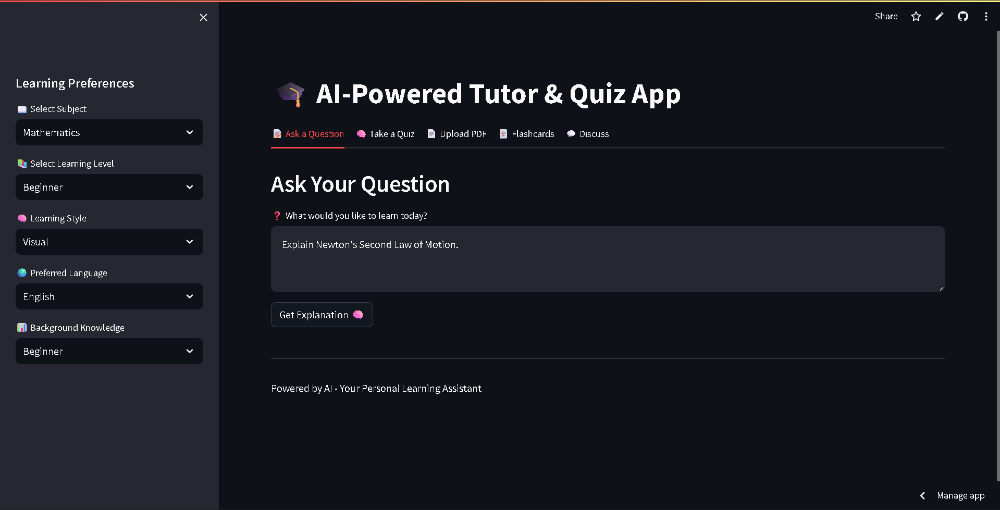

# 📚 StudyBuddy – AI-Powered Personalised Tutor & Quiz App

[](https://github.com/<your-github-username>/StudyBuddy/actions)
[](LICENSE)
[](https://share.streamlit.io/<your-github-username>/StudyBuddy/main)

---

## Table of Contents

- [Features](#features)
- [Demo](#demo--screenshots--gifs--live-link)
- [Installation](#installation--setup-instructions)
- [Usage](#usage)
- [Project Structure](#project-structure)
- [Tech Stack](#tech-stack)
- [Contributing](#contributing-guidelines)
- [License](#license)
- [Authors & Acknowledgements](#authors--credits--acknowledgements)

---

## Features

- 🎓 **Personalized AI Tutoring**: Adaptive explanations tailored to subject, level, learning style, and language.
- 📝 **Quiz Generation**: Custom, interactive multiple-choice quizzes with answer reveal and explanations.
- 📄 **PDF Upload & Analysis**: Extracts content, generates summaries, and creates flashcards from study PDFs.
- 🃏 **Flashcards**: Auto-generated, topic-based flashcards for active recall.
- 💬 **PDF Discussion Chat**: Ask questions about your uploaded PDF and get AI-powered, content-specific answers.
- 🌐 **Multi-language Support**: English, Hindi, Spanish, French.
- 🧠 **Learning Style Adaptation**: Visual, Text-based, and Hands-on learning formats.

---

## Demo / Screenshots / GIFs / Live Link



> **Live Demo:** [Streamlit Cloud Link](https://studygenie-ai.streamlit.app/)  

---

## Installation / Setup Instructions

1. **Clone the repository:**
    ```sh
    git clone https://github.com/<your-github-username>/StudyBuddy.git
    cd StudyBuddy
    ```

2. **Install dependencies:**
    ```sh
    pip install -r requirements.txt
    ```

3. **Set up environment:**
    - Copy `backend/.env.example` to `backend/.env` (this file is git-ignored).
    - Add your Google Gemini API key:
      ```
      GEMINI_API_KEY=your-gemini-api-key
      ```

4. **Start the backend (FastAPI):**
    ```sh
    cd backend
    uvicorn main:app --reload
    ```

5. **Launch the frontend (Streamlit):**
    ```sh
    cd ../frontend
    streamlit run app.py
    ```

---

## Usage

- **Ask a Question:**  
  Go to the "Ask a Question" tab, select your preferences, and get a personalized explanation.
- **Take a Quiz:**  
  Generate and interact with quizzes on your chosen subject and level.
- **Upload PDF:**  
  Upload study materials, get summaries, and auto-generated flashcards.
- **Flashcards:**  
  Review and navigate through flashcards generated from your PDF.
- **Discuss:**  
  Chat with the AI about your uploaded PDF content.

---

## Project Structure

```
StudyBuddy/
│
├── backend/
│   ├── ai_engine.py         # AI logic, prompt engineering, quiz/flashcard generation
│   ├── main.py              # FastAPI app, API endpoints
│   └── utils.py             # Utility functions (if any)
│
├── frontend/
│   └── app.py               # Streamlit UI
│
├── Images/
│   └── AITutor.png          # App screenshot(s)
│
├── requirements.txt         # Python dependencies
├── runtime.txt              # Python version
├── .env.example             # Example environment variables
├── .gitignore
└── README.md
```


---

## Tech Stack

- **Frontend:** Streamlit
- **Backend:** FastAPI
- **AI/LLM:** Google Gemini via LangChain
- **PDF Processing:** PyPDF2
- **Data Validation:** Pydantic
- **API Server:** Uvicorn
- **Environment Management:** python-dotenv

---

## Contributing Guidelines

Contributions are welcome!  
Please open issues or submit pull requests for improvements, bug fixes, or new features.

1. Fork the repo and create your branch.
2. Make your changes and add tests if applicable.
3. Ensure code style and formatting.
4. Submit a pull request with a clear description.

---

## License

This project is licensed under the [MIT License](LICENSE).

---

*Made with ❤️ for learners everywhere!*